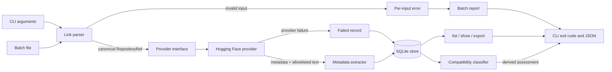

# EthiASR Bench

Open-source infrastructure for discovering, inspecting, and eventually benchmarking
Amharic automatic speech recognition (ASR) models.

> **Project status: Stage 2 complete — compatibility classification.** Stage 1 identifies and
> inspects Hugging Face model repositories and stores normalized metadata locally.
> Stage 2 adds deterministic, rule-based classification of likely inference
> compatibility from that stored metadata. Neither stage runs models, downloads model
> weights, measures audio quality, calculates WER/CER, or publishes benchmark rankings.

## Why this project exists

Amharic ASR has become more accessible, but comparing models remains difficult.
Papers, model cards, and demo pages describe different training data, tokenizers,
audio preprocessing, evaluation sets, and metrics. A model may be called "Amharic"
while documenting only part of its language coverage. Reported WER values are often
not reproducible because the test set, normalization rules, and decoding settings
are missing.

Before the community can compare models, it needs a reliable answer to more basic
questions:

- Which repositories actually claim to support Amharic?
- What architecture, library, tokenizer, and license does each repository declare?
- Which files are present, without downloading multi-gigabyte weights?
- Does the repository depend on custom Python code?
- What did the source metadata say at a specific commit?
- Which failures occurred while retrieving it?
- Is the model a likely standard Whisper candidate, a known ASR variation, or does it
  require a custom implementation?
- Which structured facts support that classification, and which parts are assumptions?

EthiASR Bench starts there. It treats model discovery and metadata normalization as
the first reusable layer of a longer evaluation pipeline, rather than as a one-off
script for a single model.

## What Stage 1 implements

- Accepts Hugging Face model repository IDs and HTTPS model URLs.
- Validates hosts, paths, credentials, ports, revisions, and repository IDs.
- Rejects lookalike domains such as `huggingface.co.attacker.example`.
- Reads batch input files with comments, blank lines, and per-line error reporting.
- Deduplicates repeated repository/revision pairs while preserving input order.
- Retrieves repository metadata through a provider interface using
  `huggingface_hub`.
- Fetches only a small allowlist of text files: `README.md`, `config.json`, and
  `requirements.txt`, each subject to a size limit; LFS-backed text files are skipped
  to avoid accidentally retrieving large artifacts.
- Normalizes metadata into a versioned Pydantic schema with explicit provenance.
- Distinguishes known, unknown, extraction-failed, and not-applicable values.
- Detects weight-like files and custom-code indicators from file listings only.
- Stores normalized records, raw provider metadata, warnings, and failures in SQLite.
- Preserves history per requested revision and resolved commit.
- Exports deterministic JSON, optionally including raw source metadata.
- Supports deliberate deletion of local repository history.
- Provides human-readable and machine-readable CLI output.
- Never downloads weights, installs repository dependencies, or executes repository
  code.

## What Stage 2 implements

- Classifies a stored inspection into one of four explicit compatibility classes:
  `standard_whisper_candidate`, `known_variation`,
  `custom_implementation_required`, or `insufficient_information`.
- Uses structured architecture, `model_type`, task, library, `auto_map`, and file
  inventory signals. Model-card prose and repository names are never architecture
  evidence.
- Separates `observed` evidence from classifier `assumptions`.
- Produces deterministic reasons, evidence, warnings, and a classifier version.
- Treats missing or conflicting metadata as `insufficient_information`, not as proof
  of incompatibility.
- Computes assessments on demand from Stage 1 records. It does not mutate stored
  metadata or require a database migration.
- Exposes the assessment through `ethi-asr classify`.
- Still downloads no weights, installs no repository dependencies, and executes no
  repository code.

The detailed rules and limitations are documented in
[`docs/compatibility.md`](docs/compatibility.md).

Reference model for examples:
[`b1n1yam/shook-medium-amharic-2k`](https://huggingface.co/b1n1yam/shook-medium-amharic-2k).

## Explicit non-goals for Stages 1–2

Stages 1–2 do **not**:

- download model weights or run inference;
- install dependencies declared by model authors;
- execute Python files from a repository;
- enable `trust_remote_code`;
- prove that a model will load or produce correct transcripts;
- claim that a model is Whisper merely because a description mentions Whisper;
- evaluate audio, calculate WER/CER, or produce rankings;
- require a GPU, PyTorch, Transformers, `torchaudio`, or audio libraries;
- provide a web server, frontend, queue, or distributed scheduler.

A compatibility class is a reviewable candidate, not a benchmark result or a
loadability guarantee.

## Quick start

Requirements: Python 3.11 or newer and network access to the Hugging Face Hub.

```bash
# From a checkout of this repository
uv sync

uv run ethi-asr --version
uv run ethi-asr inspect b1n1yam/shook-medium-amharic-2k
```

A successful human-readable result looks approximately like this (the exact
metadata depends on the repository and revision):

```text
Repository          b1n1yam/shook-medium-amharic-2k
URL                 https://huggingface.co/b1n1yam/shook-medium-amharic-2k
Status              success
Resolved commit     60b7ae174266ed42362ee02e636aea144011378d
Retrieved (UTC)     2026-10-27T12:48:03Z
Pipeline/task       automatic-speech-recognition
Architectures       WhisperForConditionalGeneration
Model type          whisper
Library             transformers
Languages           unknown
Licenses            unknown
Files               14 listed, 3061192445 known bytes, weights=yes, custom code=no
```

`Languages: unknown` is intentional if the repository does not declare language
metadata in structured form. Stage 1 does not infer "Amharic" from the model name or
from prose in the model card.

Inspect a URL, request JSON, and view the stored record:

```bash
uv run ethi-asr inspect https://huggingface.co/b1n1yam/shook-medium-amharic-2k
uv run ethi-asr inspect b1n1yam/shook-medium-amharic-2k --json
uv run ethi-asr list
uv run ethi-asr show b1n1yam/shook-medium-amharic-2k
uv run ethi-asr classify b1n1yam/shook-medium-amharic-2k
```

The default database is:

- macOS/Linux: `~/.local/share/ethi-asr-bench/records.db` (or
  `$XDG_DATA_HOME/ethi-asr-bench/records.db`)
- Windows: `%LOCALAPPDATA%\ethi-asr-bench\records.db`

Override it with `--db PATH` before the command or `ETHI_ASR_DB_PATH`:

```bash
uv run ethi-asr --db ./local.db inspect b1n1yam/shook-medium-amharic-2k
```

## Installation

### macOS and Linux (recommended: uv)

```bash
# Install uv if it is not already available
curl -LsSf https://astral.sh/uv/install.sh | sh

# From the repository root
uv sync --all-groups
uv run ethi-asr --version
```

`uv sync` installs runtime dependencies; `--all-groups` also installs the test,
lint, and type-check tools.

### macOS and Linux (pip)

```bash
python3.11 -m venv .venv
source .venv/bin/activate
python -m pip install --upgrade pip
pip install -e .
ethi-asr --version
```

For development with pip:

```bash
pip install -e .
pip install "pytest>=8.3" "pytest-cov>=5" "ruff>=0.9" "mypy>=1.14"
```

### Windows (PowerShell)

```powershell
py -3.11 -m venv .venv
.\.venv\Scripts\Activate.ps1
python -m pip install --upgrade pip
pip install -e .
ethi-asr --version
```

Or, with uv:

```powershell
winget install --id=astral-sh.uv -e
uv sync --all-groups
uv run ethi-asr --version
```

Windows may require `Set-ExecutionPolicy -Scope CurrentUser RemoteSigned` before
activating a virtual environment; follow your organization's policy.

## Usage

### Inspect one or more repositories

```bash
uv run ethi-asr inspect b1n1yam/shook-medium-amharic-2k
uv run ethi-asr inspect owner/model another/model
uv run ethi-asr inspect https://huggingface.co/owner/model --json
```

Inspection never downloads model weights. It retrieves Hub metadata and, when
present and within the size limit, three small text files.

### Pin a revision

```bash
uv run ethi-asr inspect owner/model --revision main
uv run ethi-asr inspect https://huggingface.co/owner/model/tree/main
uv run ethi-asr inspect "https://huggingface.co/owner/model?revision=main"
```

`--revision` and an embedded URL revision must agree. A bare `owner/model@main`
syntax is intentionally not accepted. The resolved commit SHA is stored with the
record, so inspecting a moved branch preserves the earlier commit's history.

### Batch input

See [`examples/model_ids.txt`](examples/model_ids.txt).

```bash
uv run ethi-asr batch examples/model_ids.txt
uv run ethi-asr batch examples/model_ids.txt --json
```

Rules:

- one repository ID or URL per line;
- blank lines and lines beginning with `#` are skipped;
- repeated repository/revision pairs are reported as duplicates, not re-inspected;
- the same repository at different revisions is not a duplicate;
- an invalid line does not stop the batch;
- a provider failure does not stop the batch;
- every result is reported against its original input and line number.

### List and show local records

```bash
uv run ethi-asr list
uv run ethi-asr list --limit 100 --json
uv run ethi-asr show b1n1yam/shook-medium-amharic-2k
uv run ethi-asr show b1n1yam/shook-medium-amharic-2k --json
uv run ethi-asr show b1n1yam/shook-medium-amharic-2k --json --include-raw
uv run ethi-asr show b1n1yam/shook-medium-amharic-2k --revision 60b7ae1
```

`show` displays the latest inspection by default. `--revision` matches a stored
requested revision, a full commit SHA, or a commit prefix. Revision-pinned URLs are
rejected by `delete` and `export --repo` because those commands operate on all stored
revisions for a repository.

### Classify compatibility

```bash
uv run ethi-asr classify b1n1yam/shook-medium-amharic-2k
uv run ethi-asr classify b1n1yam/shook-medium-amharic-2k --json
uv run ethi-asr classify b1n1yam/shook-medium-amharic-2k --revision main
```

`classify` reads the latest matching local inspection. It does not contact Hugging
Face, download files, load weights, or run model code. Run `inspect` first if the
repository is not stored locally. A typical human-readable result is:

```text
Compatibility assessment
Repository          b1n1yam/shook-medium-amharic-2k
Resolved commit     60b7ae174266ed42362ee02e636aea144011378d
Inspection status   success
Inspection schema   1.0.0
Classifier version  1.0.0
Classification      standard_whisper_candidate

Reasons
  - Structured metadata declares a Whisper architecture or Whisper model_type.
  - No auto_map custom loader declaration was observed.
  - This is a candidate for a standard Whisper path; compatibility is not proven.
```

The four classes are:

| Class | Meaning |
| ----- | ------- |
| `standard_whisper_candidate` | Structured Whisper metadata is a candidate for a future standard Transformers Whisper path. No inference has been run. |
| `known_variation` | A recognized non-Whisper ASR family, or a Whisper-family record whose declared runtime differs from the standard Transformers path. A family-specific adapter would be needed. |
| `custom_implementation_required` | `auto_map` is declared, or the structured architecture is outside the initial ASR allowlist. A custom or out-of-scope implementation would be required. |
| `insufficient_information` | Structured metadata is missing, malformed, or conflicting, including a known ASR architecture paired with an explicitly non-ASR pipeline. No compatibility conclusion is asserted. |

`--json` emits the versioned assessment object, including every observed or assumed
evidence item, reasons, and warnings. See
[`docs/compatibility.md`](docs/compatibility.md) for the exact rule order.

### Export JSON

```bash
uv run ethi-asr export --format json --output metadata.json
uv run ethi-asr export --include-raw --output metadata-with-raw.json
uv run ethi-asr export --all-history --output history.json
uv run ethi-asr export --repo b1n1yam/shook-medium-amharic-2k --output one-model.json
uv run ethi-asr export --output -          # write JSON to stdout
```

The default export contains the latest inspection for each repository. Use
`--all-history` to include every stored inspection. `--include-raw` adds the raw
provider payload stored at inspection time, which is useful for debugging and future
reprocessing.

### Delete local history

```bash
uv run ethi-asr delete b1n1yam/shook-medium-amharic-2k
uv run ethi-asr delete b1n1yam/shook-medium-amharic-2k --yes
```

Deletion removes all local inspection history for that repository. It does not
affect Hugging Face.

### Authentication

Public repositories work without a token. For legitimate Hub access and higher
rate limits, set an environment variable:

```bash
export HF_TOKEN=...        # macOS/Linux
$env:HF_TOKEN = "..."      # Windows PowerShell
```

`HF_TOKEN` (or `HUGGING_FACE_HUB_TOKEN`) is read in memory, passed to the Hub client,
and never written to the database, exports, or logs. Do not put tokens in command
line arguments.

### Exit codes

| Code | Meaning |
| ---- | ------- |
| `0` | All requested inspections completed successfully, or the command succeeded. |
| `1` | At least one inspection was partial or failed, or a requested local record was not found. |
| `2` | Invalid usage or input, configuration error, or an input file that could not be read. |
| `3` | Local persistence, export, or unexpected internal failure. |

For a mixed batch, exit code `2` takes precedence over `1` because some inputs were
unusable. `partial` inspections are never reported as successful. `classify` exits
`0` when it produces a valid assessment, including `insufficient_information`; it
exits `1` when the requested local inspection does not exist.

### JSON output

`inspect` and `batch` emit an envelope with per-input results and a summary:

```json
{
  "command": "inspect",
  "results": [
    {
      "input": "b1n1yam/shook-medium-amharic-2k",
      "line_number": null,
      "repo_id": "b1n1yam/shook-medium-amharic-2k",
      "status": "success",
      "error": null,
      "duplicate_of": null,
      "duplicate_of_line": null,
      "record": {"schema_version": "1.0.0", "...": "..."}
    }
  ],
  "summary": {
    "total_inputs": 1,
    "unique_repositories": 1,
    "succeeded": 1,
    "partial": 0,
    "failed": 0,
    "invalid": 0,
    "duplicates": 0,
    "skipped": 0,
    "attempted": 1,
    "exit_code": 0
  }
}
```

Human-readable diagnostics are written to stderr; JSON is written to stdout. Fatal
command errors (for example, an unreadable batch file) use
`{"status": "error", "error": {...}}`; per-repository inspection failures use the
results envelope above.

`classify --json` emits one assessment object:

```json
{
  "classifier_version": "1.0.0",
  "classification": "standard_whisper_candidate",
  "repo_id": "b1n1yam/shook-medium-amharic-2k",
  "resolved_commit": "60b7ae174266ed42362ee02e636aea144011378d",
  "inspection_schema_version": "1.0.0",
  "inspection_status": "success",
  "reasons": ["..."],
  "evidence": [
    {
      "rule": "model.model_type",
      "kind": "observed",
      "signal": "model.model_type",
      "value": "whisper",
      "source": "config.json.model_type",
      "message": "A structured model_type was observed."
    }
  ],
  "warnings": []
}
```

Evidence with `"kind": "assumption"` is an inference made by the classifier. It is
never presented as an observed fact.

## Example normalized metadata

The following is an **abridged output from a real live inspection** of
`b1n1yam/shook-medium-amharic-2k` on 2026-10-27. File entries, tags, and provenance
entries are shortened for readability. Unknown languages and licenses are preserved
as unknown because the repository did not declare them in structured fields. The
model-card description is untrusted text; the WER value it mentions is not verified
or reproduced by Stage 1.

```json
{
  "schema_version": "1.0.0",
  "identity": {
    "repo_id": "b1n1yam/shook-medium-amharic-2k",
    "owner": "b1n1yam",
    "name": "shook-medium-amharic-2k",
    "repo_type": "model",
    "canonical_url": "https://huggingface.co/b1n1yam/shook-medium-amharic-2k",
    "resolved_commit": "60b7ae174266ed42362ee02e636aea144011378d",
    "retrieved_at": "2026-10-27T12:48:03Z"
  },
  "status": "success",
  "model": {
    "display_name": {"state": "unknown"},
    "description": {
      "state": "known",
      "value": "This model was trained from scratch on the None dataset. It achieves the following results on the evaluation set: - Loss: 0.0532 - Wer: 9.1091",
      "source": "model_card.README.md"
    },
    "architectures": {
      "state": "known",
      "value": ["WhisperForConditionalGeneration"],
      "source": "config.json.architectures"
    },
    "model_type": {"state": "known", "value": "whisper", "source": "config.json.model_type"},
    "library_name": {
      "state": "known",
      "value": "transformers",
      "source": "hub.model_info.library_name"
    },
    "pipeline_tag": {
      "state": "known",
      "value": "automatic-speech-recognition",
      "source": "hub.model_info.pipeline_tag"
    },
    "languages": {"state": "unknown"},
    "licenses": {"state": "unknown"},
    "task_tags": ["automatic-speech-recognition"],
    "tags": ["whisper", "automatic-speech-recognition"],
    "declared_metrics": ["wer"]
  },
  "contents": {
    "files": [
      {"path": "README.md", "size_bytes": 3019, "is_lfs": false},
      {"path": "config.json", "size_bytes": 1328, "is_lfs": false}
    ],
    "known_size_bytes": 3061192445,
    "unknown_size_file_count": 0,
    "has_readme": true,
    "readme_filename": "README.md",
    "has_config_json": true,
    "config_files": ["config.json", "generation_config.json", "preprocessor_config.json", "tokenizer_config.json"],
    "tokenizer_or_processor_files": ["tokenizer.json", "tokenizer_config.json", "vocab.json"],
    "has_tokenizer_or_processor": true,
    "weight_files": ["model.safetensors"],
    "has_weight_files": true,
    "has_custom_code": false,
    "generation_config_present": true
  },
  "dependencies": {
    "requirements_files": [],
    "declared_requirements": [],
    "install_instructions": [],
    "compatibility_clues": [
      "Declared library: transformers",
      "Declared pipeline: automatic-speech-recognition",
      "Transformers auto_model: AutoModelForSpeechSeq2Seq",
      "Weight-like files present (.safetensors); not downloaded."
    ]
  },
  "custom_code": {
    "python_files": [],
    "auto_map_declared": {"state": "known", "value": false, "source": "config.auto_map"},
    "trust_remote_code_mentioned": {"state": "known", "value": false, "source": "model_card.README.md"},
    "code_executed": false
  },
  "warnings": [
    {
      "code": "weights_not_downloaded",
      "message": "Model weight-like files were detected from the file listing and were not downloaded.",
      "severity": "info"
    }
  ],
  "errors": [],
  "provenance": {
    "provider": "huggingface",
    "provider_version": "1.33.0",
    "sources": ["hub.model_info", "hub.file_listing", "README.md", "config.json"]
  }
}
```

The complete schema is documented in
[`docs/metadata-schema.md`](docs/metadata-schema.md).

## Architecture



The code is split into:

| Layer | Location | Responsibility |
| ----- | -------- | -------------- |
| Domain models | `src/ethi_asr_bench/models/` | Versioned Pydantic records, compatibility assessments, value states, provenance |
| Link acceptance | `src/ethi_asr_bench/services/link_parser.py` | Host/path/revision validation, batch parsing, deduplication |
| Providers | `src/ethi_asr_bench/providers/` | Remote metadata retrieval behind a replaceable protocol |
| Extraction | `src/ethi_asr_bench/services/metadata_extractor.py` | Conservative normalization, warnings, file classification |
| Compatibility | `src/ethi_asr_bench/services/classifier.py` | Deterministic rules, evidence, and assumptions from stored records |
| Persistence | `src/ethi_asr_bench/storage/` | SQLite schema, migrations, revision-aware store |
| Orchestration | `src/ethi_asr_bench/services/` | Inspection flow, batch processing, classification, export |
| Interface | `src/ethi_asr_bench/cli.py` | Typer commands, Rich rendering, exit codes |

The provider boundary is deliberate: a second registry can be added without changing
the parser, extractor interface, store, or CLI. The normalized record is deliberately
provider-neutral; `provenance.provider` identifies where facts came from.

See [`docs/architecture.md`](docs/architecture.md) for module boundaries and
extension points.

## Technology choices

| Technology | Why |
| ---------- | --- |
| Python 3.11+ | Modern typing, `StrEnum`, `datetime.UTC`, and broad ecosystem support. |
| `huggingface_hub` | Maintained first-party client for Hub metadata and fixed-file retrieval. |
| Pydantic v2 | Validated, versioned data contracts with explicit optionality. |
| Typer | Typed command definitions and automatic help. |
| Rich | Readable tables, panels, and warnings without requiring a frontend. |
| `sqlite3` | Zero-service local persistence with transactions and migrations. |
| pytest | Unit and integration tests that run without live network access. |
| Ruff | Fast linting and formatting. |
| mypy | Typed API boundaries in the application package. |
| uv | Reproducible environment resolution with a committed `uv.lock`. |
| GitHub Actions | Repeatable lint, type-check, and test runs. |

No inference, audio, or GPU dependencies are installed in Stages 1–2.

## Data handling and local state

- Every retrieval timestamp is stored as UTC ISO 8601 with a `Z` suffix.
- Normalized records are stored as JSON in SQLite alongside indexed retrieval
  columns.
- Raw provider metadata is stored separately and only included in exports when
  `--include-raw` is used.
- Repeated inspection of the same requested revision and resolved commit updates the
  existing row instead of creating duplicates.
- A new commit creates a new row; earlier commits remain available.
- Failed attempts are stored with structured error codes and messages.
- Compatibility assessments are derived on demand and are not persisted. Stage 2
  therefore adds no database table and no schema migration.
- Credentials are never stored. `HF_TOKEN` is read from the environment.
- The database and exports are local files. Protect them according to your own data
  policy, especially when inspecting private repositories.
- Small text files are fetched into the Hugging Face client cache. Model weights are
  never requested. Allowlisted text filenames that are LFS-backed are skipped.

## Testing and quality checks

```bash
# Install development dependencies first if you did not already:
uv sync --all-groups

uv run pytest
uv run pytest --cov=ethi_asr_bench --cov-report=term-missing
uv run ruff check .
uv run ruff format --check .
uv run mypy src
```

Tests mock all Hub access and do not require network access. An optional live smoke
test is separated from the default suite:

```bash
ETHI_ASR_LIVE=1 uv run pytest tests/integration/test_live_hf.py -m live -q
```

The live test is intentionally excluded from CI so results do not depend on external
service availability.

## Security

Model repositories and their metadata are treated as untrusted.

- Repository code is never executed, imported, or installed.
- Model weights are never downloaded.
- Only exact Hugging Face hosts are accepted; host matching uses parsed hostnames.
- Credentials, non-HTTPS schemes, unexpected ports, file URLs, and unsupported paths
  are rejected.
- Metadata strings, including installation snippets and `trust_remote_code` mentions,
  are stored as untrusted descriptive data.
- Text rendered in the terminal is escaped and stripped of control/bidi characters so
  model-card content cannot inject Rich styling or terminal sequences. JSON output
  escapes those characters while preserving decoded metadata.
- SQL uses parameterized statements.
- File paths advertised by a repository are validated before inventory storage and
  are never used for local reads.
- Tokens are redacted from stored provider error messages.
- The Stage 2 classifier consumes validated local records only. It does not resolve
  `auto_map`, follow links, install packages, or load model code.

Stages 1–2 do not need a sandbox because they do not execute remote code. Any future
inference stage must design isolation first. See
[`docs/threat-model.md`](docs/threat-model.md) and [`SECURITY.md`](SECURITY.md).

## Known limitations

- Only Hugging Face model repositories are supported.
- Stages 1–2 are designed around public repositories. A user-supplied token may
  permit access to private repository metadata, which then remains in local state; no
  private dataset or model-weight access is attempted.
- Language, license, architecture, and compatibility are never inferred from prose or
  repository names. Missing structured declarations remain `unknown`, and the
  classifier returns `insufficient_information` rather than guessing.
- Language-tag recognition uses an ISO 639 allowlist and can miss unusual or
  misspelled tags.
- Weight-file detection is filename-based. It is useful as an indicator, not as a
  guarantee that a repository is loadable.
- Model-card summaries use the first readable paragraph and are truncated.
- LFS-backed `README.md`, `config.json`, and `requirements.txt` files are skipped
  rather than downloaded, even when small, to avoid accidentally retrieving large
  artifacts through an allowlisted text filename.
- `requirements.txt` and installation snippets are descriptive metadata only.
- The provider currently supports a single registry; no plugin discovery mechanism is
  needed yet.
- SQLite is intended for local, single-user CLI use. There is no concurrent worker or
  server mode.
- Schema version `1.0.0` has no migration reader for future record versions; the
  project will add explicit schema migrations before changing stored contracts.
- A partial inspection means one or more requested/expected facts could not be
  retrieved or normalized. It does not mean a model is broken.
- Compatibility classification uses a deliberately small initial architecture
  allowlist. A recognized model can still fail to load, and an unlisted model can
  still be usable through an implementation this classifier does not know about.
- Task tags can establish that a repository declares ASR, but they cannot replace a
  structured architecture. File inventory can add warnings; it does not by itself
  change the compatibility class.
- `standard_whisper_candidate` is not a promise of successful inference. Stage 2 does
  not test tokenizer behavior, audio preprocessing, decoding, or output quality.

## Roadmap

Stages 1 and 2 are implemented. Later stages are not.

1. **Stage 1 — Metadata foundation (complete).** Link acceptance, provider abstraction,
   normalized records, SQLite history, JSON export, tests, docs, CI.
2. **Stage 2 — Compatibility classification (complete).** Deterministic, source-backed
   compatibility assessments with observed evidence, assumptions, warnings, and a
   versioned contract. No model code is executed and no database migration is needed.
3. **Stage 3 — Isolated execution environments.** Design sandboxing, dependency
   isolation, network policy, resource limits, and artifact provenance before any
   custom model code runs.
4. **Stage 4 — Standard model runner.** A shared prediction contract for Whisper
   fine-tunes first, then additional ASR families.
5. **Stage 5 — Dataset and audio pipeline.** Versioned manifests, checksums, audio
   decoding, resampling, and reproducible splits.
6. **Stage 6 — Evaluation.** WER, CER, normalization rules, confidence intervals, and
   failure accounting.
7. **Stage 7 — Publication.** Versioned result artifacts, reproducible reports, and a
   transparent comparison interface.

See [`docs/roadmap.md`](docs/roadmap.md) for completion criteria.

## Contributing

Contributions are welcome from Ethiopian AI developers, researchers, students,
linguists, and maintainers of ASR models or datasets.

Useful contributions include:

- parser and security edge cases;
- additional metadata fixtures from diverse model families;
- documentation corrections;
- tests that expose ambiguous metadata;
- reviews of language-tag and license handling;
- proposals for later-stage evaluation design.

Start with [`CONTRIBUTING.md`](CONTRIBUTING.md). Security reports should follow
[`SECURITY.md`](SECURITY.md), not a public issue. Community behavior is governed by
[`CODE_OF_CONDUCT.md`](CODE_OF_CONDUCT.md).

## Documentation

- [Architecture](docs/architecture.md)
- [Metadata schema](docs/metadata-schema.md)
- [Compatibility rules](docs/compatibility.md)
- [Roadmap](docs/roadmap.md)
- [Threat model](docs/threat-model.md)
- [Contributing](CONTRIBUTING.md)
- [Security policy](SECURITY.md)
- [Code of conduct](CODE_OF_CONDUCT.md)

## License

MIT. Copyright (c) 2026 Henok Tekeba. See [LICENSE](LICENSE).

## Acknowledgements

This project builds on the Hugging Face Hub client, Pydantic, Typer, Rich, pytest,
Ruff, and mypy. It is motivated by the work of Ethiopian researchers, developers,
language communities, and open-source model maintainers who make Amharic speech data
and models available for study.

If you work on Amharic or other Ethiopian-language speech technology, your review,
test fixture, bug report, or design critique can make this infrastructure more useful
for everyone.
