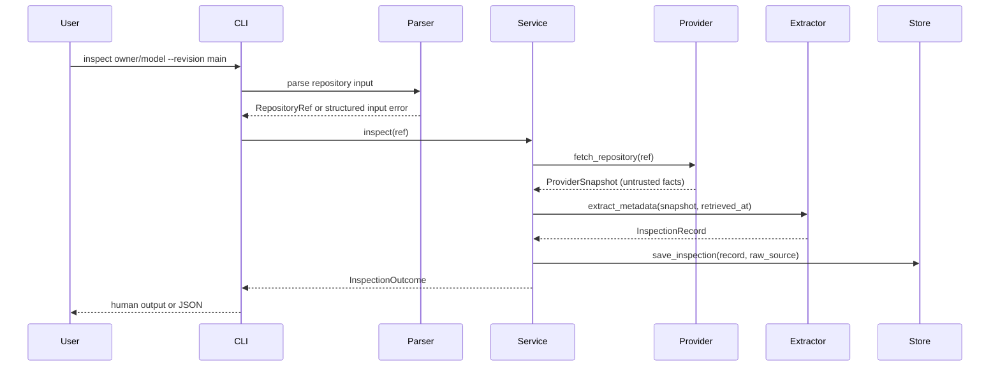

# Architecture

This document describes the Stage 1 implementation and the boundaries intended to
support later compatibility classification, isolated execution, and evaluation.

## Design goals

1. Accept untrusted model references without letting them become paths, shell
   arguments, URLs to follow, or code to execute.
2. Keep remote access behind a narrow provider interface.
3. Normalize facts conservatively and preserve provenance.
4. Persist enough history to explain what was known at a revision and when.
5. Make later stages additive rather than requiring a rewrite.

## Component map

```text
src/ethi_asr_bench/
├── cli.py                         Typer commands and Rich rendering
├── config.py                      Environment settings and local paths
├── errors.py                      Stable error codes and categories
├── utils.py                       UTC formatting, truncation, redaction
├── models/
│   └── repository.py              Versioned Pydantic domain contracts
├── services/
│   ├── link_parser.py             Validation, canonicalization, batch parsing
│   ├── inspection.py              Provider → extractor → store orchestration
│   ├── metadata_extractor.py      Conservative normalization and classification
│   ├── batch.py                   Per-input results and summaries
│   └── exporter.py                Export envelope and atomic JSON writing
├── providers/
│   ├── base.py                    Provider protocol and snapshot dataclasses
│   └── huggingface.py             Hugging Face implementation and error mapping
└── storage/
    ├── database.py                SQLite connection and forward migrations
    └── repository_store.py        Persistence interface and SQLite store
```

Dependencies point inward:

```text
CLI → services → providers/storage → models → errors/utils
```

Providers do not import services. Storage does not import providers. The metadata
extractor depends on provider-neutral snapshot types, not on `HuggingFaceProvider`.

## Data flow

### Single inspection



If the provider fails with a known failure, the service builds a failed
`InspectionRecord`, stores it, and returns it. If local persistence fails, the error
propagates; the CLI exits with code 3 rather than claiming a successful batch.

### Batch inspection

The batch layer receives a `ParseResult` from `link_parser`:

- invalid inputs are represented without a provider call;
- duplicates reference the first accepted input and line number;
- valid unique inputs are inspected in order;
- results are accumulated even when earlier repositories fail;
- the summary maps outcomes to exit codes.

`report_without_inspection` handles the all-invalid case without opening a database.

### Export

`RepositoryStore.export_records` returns persisted records. `exporter` adds:

- `export_format_version`
- record `schema_version`
- `generated_by`
- UTC `exported_at`
- a `records` array

Raw provider metadata is included only on request. Writing uses a temporary file in
the destination directory and `os.replace`, avoiding partially written exports.

## Trust boundaries

| Boundary | Trust | Control |
| -------- | ----- | ------- |
| CLI input | Untrusted | Parser validates exact hosts, paths, revisions, credentials, ports, and ID syntax. |
| Batch file | Untrusted | Size limit, UTF-8 validation, per-line parsing, comments and blank lines ignored. |
| Hub response | Untrusted | Pydantic snapshots, conservative extractor, no URL following. |
| Model card text | Untrusted | Stored as descriptive text; escaped for terminal display; never interpreted as instructions. |
| Repository files | Untrusted | Inventory only. Only three fixed, non-LFS text filenames may be fetched, with size limits. |
| SQLite content | Locally trusted but validated on read | Parameterized SQL, schema validation on load. |
| Environment | Secret-bearing | Token is read into memory only; never persisted or logged. |

## Link acceptance

`parse_repository_target` uses `urllib.parse.urlsplit` and exact hostname comparison
against `huggingface.co` and `www.huggingface.co`. It rejects:

- non-HTTPS schemes;
- embedded credentials;
- any port other than the default 443;
- lookalike or subdomain hosts;
- fragments, unknown query parameters, and duplicate revision parameters;
- dataset, space, file, and site paths;
- percent-encoded repository paths;
- empty path segments;
- malformed repository segments and revisions.

Bare IDs accept `owner/model` and single-segment model names. URLs support
`/owner/model`, `/owner/model/tree/<revision>`, and `?revision=<revision>`. The
parser produces a canonical `RepositoryRef`. Domain models also enforce patterns, but
the parser is the canonical semantic validator.

Syntactic validation is separate from remote existence checks. Only valid references
reach a provider.

## Provider contract

```python
class RepositoryProvider(Protocol):
    name: str

    def fetch_repository(self, ref: RepositoryRef) -> ProviderSnapshot: ...
```

`ProviderSnapshot` contains raw facts and optional small text files. It contains no
normalized opinion about compatibility, language, or licenses.

The Hugging Face provider:

- calls `HfApi.model_info(..., files_metadata=True, timeout=...)`;
- validates the returned repository ID and commit identifier;
- maps Hub/HTTP failures to stable `ProviderError` codes;
- retries only transient failures with bounded exponential backoff and respects
  `Retry-After`, capped at 30 seconds;
- downloads only `README.md`, `config.json`, and `requirements.txt`, each below the
  configured byte limit and not LFS-backed;
- records optional text-file failures as warnings rather than discarding successful
  repository metadata;
- never requests weight files.

## Extraction rules

The extractor uses structured sources before prose:

| Field | Preferred source | Fallback |
| ----- | ---------------- | -------- |
| architectures | downloaded `config.json` | Hub `config.architectures` |
| model type | downloaded `config.json` | Hub `config.model_type` |
| library | Hub `library_name` | model-card `library_name` |
| pipeline | Hub `pipeline_tag` | model-card `pipeline_tag` |
| languages | model-card `language`, allowlisted Hub language tags | unknown |
| licenses | model-card license, `license:` tags | unknown |
| display name | model-card `model_name`/`name` | unknown |
| description | first readable model-card paragraph | unknown |
| custom code | `.py` files, `config.auto_map`, card mention | unknown |

Prose is never used to classify architecture. A description saying "Whisper" does not
populate `architectures` or `model_type`.

### Epistemic states

`ObservedValue[T]` distinguishes:

- `known`: a non-empty value with a source;
- `unknown`: the source did not provide the field;
- `extraction_failed`: the source appeared to provide it but normalization failed;
- `not_applicable`: the field does not apply.

This avoids the common false claim that absence of evidence is evidence of absence.

### Status

- `success`: no warning-severity issues.
- `partial`: at least one warning-severity issue, such as an unreadable README,
  malformed structured metadata, unsafe file paths, an unresolved commit, or a
  truncated inventory.
- `failed`: inspection could not produce usable metadata; at least one structured
  error is present.

Informational notes (detected weights, custom code, install snippets) do not make a
record partial.

## Persistence model

Schema version 1 has two tables:

- `repositories`: canonical identity and first/last inspection timestamps.
- `inspections`: one row per repository/revision/commit result, including normalized
  JSON, raw JSON, provider, status, and first error.

A partial unique index preserves idempotency for successful and partial inspections:

```sql
(repo_id, IFNULL(requested_revision, ''), resolved_commit)
WHERE resolved_commit IS NOT NULL AND status IN ('success', 'partial')
```

Consequences:

- repeating the same requested revision at the same commit updates one row;
- a moved branch creates a new row for the new commit;
- inspecting the same commit through two different requested revisions records both;
- failed attempts are appended, retaining their history.

Schema migrations are forward-only and tracked with `PRAGMA user_version`. The
application refuses a database whose schema is newer than it understands.

## Extension points

### Adding a provider

Implement `RepositoryProvider`, return a `ProviderSnapshot`, and map failures to
`ProviderError`. The parser, extractor, store, and CLI require no changes. Provider
identity is recorded in `provenance.provider`.

### Adding metadata fields

1. Add an optional or observed field to the Pydantic model.
2. Extract it with provenance and warnings.
3. Bump the schema version according to the policy in
   [`metadata-schema.md`](metadata-schema.md).
4. Add a migration or record compatibility behavior.

### Compatibility classification

A later classifier should consume stored `InspectionRecord` objects and emit a
separate classification record with its own schema and evidence. It must not mutate
historical metadata. Missing structured facts should produce `unknown`, not a guessed
class.

### Isolated execution and evaluation

The eventual runner should depend on a selection of stored records and emit a shared
prediction contract. It should not be embedded in the metadata extractor. Sandboxing,
dependency isolation, resource limits, and provenance must be designed before custom
code is executed. See [`threat-model.md`](threat-model.md).

## Failure behavior

- Validation errors: no provider call, no record, exit code 2.
- Provider errors: failed record stored, exit code 1 in a batch.
- Partial extraction: partial record stored, exit code 1.
- Storage errors: propagate, exit code 3.
- Unexpected internal errors: not reported as success; a failed record is stored where
  possible.

No exception is silently swallowed. Provider and extraction boundaries log without
including tokens.
